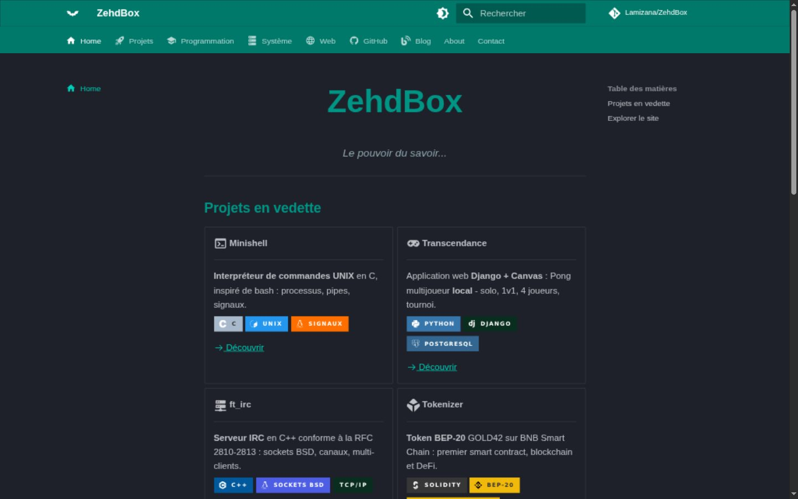

<p align="center">
  
  
  
  
  
</p>

<h1 align="center">ZehdBox</h1>

<p align="center">
  <strong>Base de connaissances de développement & portfolio</strong>
</p>

<p align="center">
  Python, Data Science, Web, Système.
</p>

---

## Sommaire

<details>
<summary>Déplier le sommaire</summary>

- [À propos](#à-propos)
- [Fonctionnalités](#fonctionnalités)
- [Stack technique](#stack-technique)
- [Structure du projet](#structure-du-projet)
- [Projets](#projets)
- [Cours](#cours)
- [Installation](#installation)
- [Commandes](#commandes)
- [CI/CD](#cicd)
- [Contribution](#contribution)
- [Auteur](#auteur)
- [Remerciements](#remerciements)
- [Licence](#licence)

</details>

---

## À propos

**ZehdBox** est un site vitrine & base de connaissances personnel, couvrant le développement logiciel, la data science, le web et le système. Il sert à la fois de **portfolio pour les recruteurs** et de **mémo technique** alimenté au fil de l'apprentissage.

Contenu structuré, déployé automatiquement via GitHub Actions sur GitHub Pages.

**Live** : [lamizana.github.io/ZehdBox](https://lamizana.github.io/ZehdBox/)

### Aperçu du site

<p align="center">
  
</p>

<details>
<summary>Thème sombre</summary>

<p align="center">
  
</p>

</details>

---

## Fonctionnalités

- **Cours Python complet** : bases du langage, exercices, fonctions, bibliothèques (NumPy, Pandas, Scikit-learn), régression linéaire, Django
- **9 fiches projets** détaillées : contexte, stack, défis techniques, résultats
- **Blog technique** avec articles et images
- **Cours Système** : Linux, Windows
- **Cours Web** : Web2, Web3, blockchain
- **Tutoriels Strudel** : audio live coding
- **Recherche full-text** intégrée
- **Mode sombre automatique** (selon les préférences système)
- **Responsive design** (mobile, tablette, desktop)
- **Déploiement automatique** via GitHub Actions

---

## Stack technique

| Catégorie | Technologie | Badge |
| --- | --- | --- |
| **Générateur** | ProperDocs + Material for MkDocs |  |
| **Thème** | Material for MkDocs |  |
| **Langage** | Python 3.12 |  |
| **Extensions** | PyMdown, Mermaid, Admonitions, Content Tabs |  |
| **CI/CD** | GitHub Actions |  |
| **Hébergement** | GitHub Pages |  |
| **Recherche** | Plugin search (built-in) |  |

### Extensions Markdown activées

| Extension | Usage |
| --- | --- |
| `pymdownx.highlight` | Coloration syntaxique du code |
| `pymdownx.superfences` | Fenced code blocks avancés + Mermaid |
| `pymdownx.tabbed` | Onglets de contenu (alternates) |
| `pymdownx.details` | Admonitions repliables |
| `pymdownx.emoji` | Icônes Material Design |
| `pymdownx.tasklist` | Listes de tâches cochables |
| `attr_list` + `md_in_html` | Grid cards et boutons |
| `admonition` | Blocs d'information (note, tip, warning) |

---

## Structure du projet

```text
ZehdBox/
├── .github/
│   ├── assets/                     # Aperçus du site utilisés par ce README
│   └── workflows/deploy.yml        # CI/CD GitHub Actions
├── ZehdBox/
│   ├── properdocs.yml              # Configuration du site
│   ├── docs/
│   │   ├── index.md                # Accueil
│   │   ├── projets/                # 9 fiches projets
│   │   ├── cours/
│   │   │   ├── index.md            # Hub des cours
│   │   │   └── python/
│   │   │       ├── bases/          # Variables, types, opérateurs, chaînes, flux
│   │   │       ├── exercices/      # Exercices nombres & chaînes
│   │   │       ├── fonctions.md    # Fonctions Python
│   │   │       ├── librairies/     # Hub du parcours data science
│   │   │       ├── numpy/          # NumPy + projet Dés
│   │   │       ├── pandas/         # Pandas + tutoriel et exercices Météo
│   │   │       ├── scikit-learn.md # Machine learning
│   │   │       └── django/         # Installation, modèles, vues, templates
│   │   ├── ia/                     # Intelligence artificielle : régression linéaire, DSLR
│   │   ├── blog/                   # Articles techniques
│   │   ├── systeme/                # Linux & Windows
│   │   ├── web/                    # Web 2.0, Web 3.0, blockchain
│   │   ├── strudel/                # Tutoriels audio live coding
│   │   ├── github/                 # Git & GitHub
│   │   ├── mkdocs/                 # Documentation du générateur
│   │   ├── about.md, contact.md    # Pages vitrine
│   │   ├── tags.md                 # Index des tags
│   │   ├── images/                 # Images du site
│   │   └── css/custom.css          # Styles personnalisés
│   ├── overrides/sitemap.xml       # Sitemap aux dates de révision git
│   ├── scripts/check_ci_parity.py  # Garde-fou : parité plugins / requirements
│   ├── requirements-ci.txt         # Dépendances figées (CI)
│   ├── requirements-dev.txt        # Dépendances de développement
│   └── site/                       # Site généré (ignoré par Git)
├── LICENSE                         # MIT
├── TODO.md                         # Suivi de l'indexation Google
└── README.md
```

---

## Projets

> **Inventaire complet des 9 fiches projets** (même liste et ordre que [`projets/index.md`](https://lamizana.github.io/ZehdBox/projets/)).

| Projet | Description | Stack |
| --- | --- | --- |
| [**Transcendance**](https://lamizana.github.io/ZehdBox/projets/transcendance/) | Pong multijoueur local - solo, 1v1, 4 joueurs, tournoi |       |
| [**Tokenizer**](https://lamizana.github.io/ZehdBox/projets/tokenizer/) | Token BEP-20 GOLD42 (BNB Smart Chain testnet) |    |
| [**TokenizeArt**](https://lamizana.github.io/ZehdBox/projets/tokenizeart/) | NFT BEP-721 `Zehd42` sur BNB Smart Chain testnet, métadonnées sur IPFS |      |
| [**Linear Regression**](https://lamizana.github.io/ZehdBox/projets/linear-regression/) | Régression linéaire - descente de gradient (projet 42) |     |
| [**DSLR**](https://lamizana.github.io/ZehdBox/projets/dslr/) | Régression logistique multiclasse - le Choixpeau de Poudlard (projet 42) |     |
| [**Minishell**](https://lamizana.github.io/ZehdBox/projets/minishell/) | Interpréteur de commandes UNIX |   |
| [**ft_irc**](https://lamizana.github.io/ZehdBox/projets/ft_irc/) | Serveur IRC en C++ (RFC 2810-2813) |   |
| [**Push Swap**](https://lamizana.github.io/ZehdBox/projets/push_swap/) | Algorithme de tri optimisé en C |   |
| [**So Long**](https://lamizana.github.io/ZehdBox/projets/so_long/) | Jeu 2D en C (MiniLibX) |   |

---

## Cours

### Python

| Section | Contenu | Lien |
| --- | --- | --- |
| **Les bases** | Variables, types, opérateurs, chaînes, flux, répétitives | [Bases](https://lamizana.github.io/ZehdBox/cours/python/bases/) |
| **Exercices** | 15 exercices de révision + exercices chaînes | [Exercices](https://lamizana.github.io/ZehdBox/cours/python/exercices/) |
| **Fonctions** | Définir, appeler, return, portée, docstrings | [Fonctions](https://lamizana.github.io/ZehdBox/cours/python/fonctions/) |
| **Bibliothèques** | Le parcours data science : point d'entrée des trois sections suivantes | [Bibliothèques](https://lamizana.github.io/ZehdBox/cours/python/librairies/) |
| ↳ **NumPy** | Tableaux, opérations vectorielles, projet Dés | [NumPy](https://lamizana.github.io/ZehdBox/cours/python/numpy/) |
| ↳ **Pandas** | DataFrames, tutoriel Météo, exercices API | [Pandas](https://lamizana.github.io/ZehdBox/cours/python/pandas/) |
| ↳ **Scikit-learn** | Machine learning : classification, régression | [Scikit-learn](https://lamizana.github.io/ZehdBox/cours/python/scikit-learn/) |
| **Django** | Installation, Docker & PostgreSQL, modèles, vues, templates | [Django](https://lamizana.github.io/ZehdBox/cours/python/django/) |

### IA

| Section | Contenu | Lien |
| --- | --- | --- |
| **Intelligence Artificielle** | Les modèles codés de zéro : régression linéaire et régression logistique | [IA](https://lamizana.github.io/ZehdBox/ia/) |
| ↳ **Régression linéaire** | Moindres carrés et descente de gradient codés de zéro | [Régression linéaire](https://lamizana.github.io/ZehdBox/ia/linear-regression/) |
| ↳ **DSLR** | Régression logistique multiclasse : le Choixpeau de Poudlard | [DSLR](https://lamizana.github.io/ZehdBox/ia/dslr/) |

### Autres domaines

| Domaine | Pages | Lien |
| --- | --- | --- |
| **Système** | Linux, Windows | [Système](https://lamizana.github.io/ZehdBox/systeme/) |
| **Web** | Web2, Web3, blockchain | [Web](https://lamizana.github.io/ZehdBox/web/) |
| **Git & GitHub** | Commandes, workflows | [GitHub](https://lamizana.github.io/ZehdBox/github/) |
| **MkDocs** | Documentation, thèmes | [MkDocs](https://lamizana.github.io/ZehdBox/mkdocs/) |
| **Blog** | Articles techniques | [Blog](https://lamizana.github.io/ZehdBox/blog/) |
| **Strudel** | Tutoriels audio live coding | [Strudel](https://lamizana.github.io/ZehdBox/strudel/) |

---

## Installation

### Prérequis

- Python 3.12+
- pip

### Installation locale

```bash
# 1. Cloner le dépôt
git clone https://github.com/Lamizana/ZehdBox.git
cd ZehdBox

# 2. Créer et activer l'environnement virtuel
python3 -m venv .env
source .env/bin/activate

# 3. Installer les dépendances (CI + outils de développement)
cd ZehdBox
pip install --upgrade pip
pip install -r requirements-dev.txt

# 4. Lancer le serveur local
properdocs serve --dev-addr=127.0.0.1:8001 --livereload
```

Le site sera accessible sur `http://127.0.0.1:8001`.

> [!NOTE]
> `requirements-ci.txt` fige les versions utilisées par le workflow de déploiement ; `requirements-dev.txt` l'inclut (`-r requirements-ci.txt`) et ajoute les outils de développement local. Le script `scripts/check_ci_parity.py` vérifie que les deux restent cohérents avec `properdocs.yml`.

---

## Commandes

| Commande | Description |
| --- | --- |
| `properdocs serve --dev-addr=127.0.0.1:8001 --livereload` | Serveur local avec rechargement à chaud |
| `properdocs build -f properdocs.yml --strict` | Build de validation (avertissements = erreurs) |
| `python scripts/check_ci_parity.py` | Vérifie que chaque plugin de `properdocs.yml` est installé par `requirements-ci.txt` |

> [!WARNING]
> Toutes les commandes doivent être lancées **depuis le dossier `ZehdBox/`** avec l'environnement virtuel activé.

```bash
# Serveur local
properdocs serve --dev-addr=127.0.0.1:8001 --livereload

# Build de validation
properdocs build -f properdocs.yml --strict

# Contrôle de parité plugins / requirements (à lancer avant de committer)
python scripts/check_ci_parity.py
```

> [!NOTE]
> Le déploiement **ne se fait pas en local** : un simple `git push` sur `main` déclenche le workflow GitHub Actions (voir la section [CI/CD](#cicd) ci-dessous). La commande `properdocs gh-deploy` n'est donc pas utilisée par ce projet.

---

## CI/CD

Le déploiement est automatisé via **GitHub Actions** (`deploy.yml`) :

1. **Push sur `main`** → déclenche le workflow
2. **Contrôle de parité** → `scripts/check_ci_parity.py` vérifie que chaque plugin déclaré dans `properdocs.yml` est bien installé par `requirements-ci.txt`
3. **Build strict** → le build échoue au moindre avertissement (liens cassés, références manquantes)
4. **Upload artifact** → archivage du site généré
5. **Deploy** → déploiement sur GitHub Pages

Le workflow utilise `fetch-depth: 0` pour conserver l'historique git complet (nécessaire pour `git-revision-date-localized`).

> [!IMPORTANT]
> **Aucune commande de déploiement manuelle n'est nécessaire.** Le workflow est la seule source de vérité pour la mise en ligne ; ne pas publier via une branche `gh-pages` (vestige de l'ancien déploiement MkDocs, désormais abandonné).

---

## Contribution

Ce dépôt est un projet personnel : les corrections et les remarques restent bienvenues.

1. **Fork** le dépôt
2. **Créer une branche** depuis `main` : `git checkout -b docs/typo-bases`
3. **Committer** en suivant la convention ci-dessous
4. **Pousser** la branche : `git push origin docs/typo-bases`
5. **Ouvrir une Pull Request** en décrivant le changement

> [!TIP]
> Avant de pousser, lancer le build local (`properdocs build -f properdocs.yml --strict`) : la CI échoue au moindre avertissement.

### Convention de commits

Le projet suit [Conventional Commits](https://www.conventionalcommits.org/fr/), avec une ligne de sujet en français :

```text
<type>(<scope>): <description>
```

- description à l'impératif présent, **sans point final**
- ligne de sujet ≤ 72 caractères
- un commit = un changement identifiable

| Type | Usage |
| --- | --- |
| `feat` | Nouvelle page ou nouvelle fonctionnalité |
| `fix` | Correction de bug ou d'information erronée |
| `docs` | Contenu, documentation |
| `style` | Mise en forme, CSS, thème |
| `perf` | Optimisation (images, vidéos) |
| `refactor` | Réécriture sans changement de comportement |
| `test` | Ajout ou correction de tests |
| `chore` | Maintenance, dépendances, outillage |
| `revert` | Annulation d'un commit |

**Scopes** : `nav`, `ia`, `python`, `exercices`, `projets`, `web`, `systeme`, `blog`, `css`, `config`, `seo`, `readme`, `deps`, `ci`.

Exemples issus de l'historique du dépôt :

```text
docs(web): documente le déploiement du contrat BEP-20
fix(seo): ajoute la description des pages projets
style(css): corrige le contraste des cartes en mode sombre
```

---

## Auteur

**Alex Lamizana** — étudiant à 42 Angoulême, spécialisation Data & IA

- [Site](https://lamizana.github.io/ZehdBox/)
- [GitHub](https://github.com/Lamizana)
- [Contact](https://lamizana.github.io/ZehdBox/contact/)

---

## Remerciements

- [ProperDocs](https://pypi.org/project/properdocs/) — générateur du site, successeur maintenu de MkDocs
- [Material for MkDocs](https://squidfunk.github.io/mkdocs-material/) — thème du site
- [PyMdown Extensions](https://facelessuser.github.io/pymdown-extensions/) — onglets, admonitions, emoji
- [shields.io](https://shields.io/) — badges de ce README

---

## Licence

Distribué sous licence **MIT** (SPDX : `MIT`). Voir [`LICENSE`](LICENSE).

© 2026 Alex Lamizana
