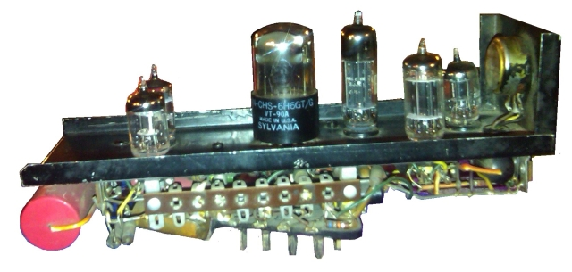

# Histoire de l'Intelligence Artificielle

    De l'article fondateur de Turing aux modèles de langage actuels : la grande aventure de l'IA.

---

## Turing & l'article fondateur

Si le terme d'intelligence artificielle n'apparaît qu'en **1956**, on s'accorde aujourd'hui à dater sa naissance officielle avec la publication d'un article d'[***Alan Turing***](https://fr.wikipedia.org/wiki/Alan_Turing){ target="_blank" } en **1950**. Ce dernier pose en effet les bases de ce que serait l'intelligence pour une machine et propose un moyen de la tester.

**Octobre 1950** : Le mathématicien britannique Alan Turing signe l'un de ses articles les plus célèbres : ***Computing Machinery and Intelligence***. Ce texte fondateur et visionnaire commence par ces mots :

- « Je propose d'examiner la question : "*Les machines peuvent-elles penser ?*" »

Pour y répondre, il imagine une expérience de pensée baptisée le « jeu de l'imitation » (**Imitation Game**), aujourd'hui connue sous le nom de **test de Turing** :

- Il permet d'évaluer l'intelligence d'une machine à travers sa capacité à converser comme un humain.

Déjà célèbre pour avoir conçu durant la Seconde Guerre mondiale la machine électromécanique (la Bombe) qui permit de décrypter les communications allemandes chiffrées par **Enigma**, Turing pose ici les bases conceptuelles de l'intelligence artificielle.

!!! note "À savoir"
    **1950 (L'article fondateur d'Alan Turing)** : En octobre 1950, le mathématicien britannique Alan Turing publie un article majeur dans la revue philosophique *Mind*.

    Il y pose la question « *Can machines think?* » (« Les machines peuvent-elles penser ? ») et propose de la remplacer par un protocole expérimental : le « ***jeu de l'imitation*** » (**Imitation Game**), aujourd'hui universellement connu sous le nom de **test de Turing**.

---

**Turing** expose dans son article ce que sont le calcul formel, l'algorithme et le fonctionnement des ordinateurs.

Ses considérations concernent aussi les capacités de calcul (et de mémoire) nécessaires au déploiement d'une intelligence. Elles le conduisent à discuter des **limitations théoriques des machines**, en relation avec des questions de calculabilité et de logique formelle, elles-mêmes liées aux fondements des mathématiques.

Ce texte développe également l'idée que **la puissance de calcul des machines amènera ou nous amènera nécessairement à nous poser la question du statut de l'intelligence**.

Il annonce que, si c'est par sa faculté de raisonnement que nous créditons autrui d'une certaine intelligence, comment réagirons-nous face à un calculateur électronique ?

Turing expose un test : "**Imitation Game**" (Le Jeu de l'Imitation)

- Il met en évidence les traces d'un raisonnement intelligent.

Son article fondateur ouvre la voie aux développements et expérimentations qui vont suivre, pour aboutir à la naissance des recherches sur l'intelligence artificielle en 1956.

- :material-file-pdf-box:{ .lg .middle } __Version anglaise originale__

    ---

    **Computing Machinery and Intelligence**  
    *Mind*, Vol. 59, No. 236, pp. 433–460 (octobre 1950)

    [:material-download: Télécharger le PDF (EN)](assets/Turing_1950_Computing_Machinery_and_Intelligence_EN.pdf){ .md-button .md-button--primary }

- :material-file-pdf-box:{ .lg .middle } __Traduction française (nettoyée)__

    ---

    **Machines informatiques et intelligence**  
    Traduction intégrale de l'article fondateur, nettoyée et reformatée.

    [:material-download: Télécharger le PDF (FR)](assets/Turing_1950_Machines_Informatiques_et_Intelligence_FR.pdf){ .md-button .md-button--primary }

!!! note "Note sur la traduction"
    La traduction française a été générée automatiquement (`onlinedoctranslator.com`) puis nettoyée et reformatée manuellement (correction de la citation de Lady [***Ada Lovelace***](https://fr.wikipedia.org/wiki/Ada_Lovelace){ target="_blank" }, suppression des artefacts d'extraction, structuration Markdown → PDF). L'article original est dans le domaine public.

---

## La création du SNARC

Le mathématicien **américain** [***Marvin Minsky***](https://fr.wikipedia.org/wiki/Marvin_Minsky){ target="_blank" } crée, avec son associé ***Dean Edmonds***, une machine, le **SNARC** (**Stochastic Neural Analog Reinforcement Calculator**), qui n'est rien d'autre que le **premier simulateur neuronal** (**réseau neuronal**).

<figure markdown>
  { width=600 }
  <figcaption>Le SNARC (Stochastic Neural Analog Reinforcement Calculator). Premier simulateur de réseau neuronal, construit par Marvin Minsky et Dean Edmonds en 1951 à Harvard.</figcaption>
</figure>

Le SNARC a été conçu pour simuler un rat virtuel cherchant la sortie d'un labyrinthe.

---

## 1955-1956 — Vers Dartmouth : la naissance de l'IA

**1955** — ***Minsky*** (28 ans à l'**époque**), rédige avec ***John McCarthy***, un projet d'école d'**été** pour **développer** une nouvelle discipline qu'ils **décident** de nommer « intelligence artificielle », et qui vise **à** étudier les différentes facettes de l'intelligence en les **simulant** avec des ordinateurs.

**1956** — Après avoir fait parrainer leur projet par ***Nick Rochester***, le directeur scientifique d'**IBM**, et surtout par le très célèbre ***Claude Shannon***, le père de la théorie de l'information, ils le **soumettent** à la **fondation Rockefeller**, qui **accepte** de le financer.

## 1956 — La conférence de Dartmouth : la naissance du terme

L'été 1956, [***John McCarthy***](https://fr.wikipedia.org/wiki/John_McCarthy){ target="_blank" }, **Marvin Minsky**, **Nathaniel Rochester** et **Claude Shannon** organisent à Dartmouth College (New Hampshire) le *Dartmouth Summer Research Project on Artificial Intelligence*. C'est là que le terme **« Intelligence Artificielle »** est officiellement adopté.

Elle est officiellement reconnue comme l'acte de naissance de l'intelligence artificielle en tant que **discipline scientifique autonome**.

!!! info "**Proposition fondatrice**"
    « *Toute aspect de l'apprentissage ou toute autre caractéristique de l'intelligence peut en principe être décrit avec assez de précision pour qu'une machine puisse être construite pour la simuler.* »

Cette discipline scientifique repose sur le fait et sur la conjecture selon laquelle toutes **les fonctions cognitives** (l'apprentissage, le raisonnement, le calcul, la perception, la mémorisation, voire la découverte scientifique ou la créativité artistique) peuvent être décrites avec une précision telle qu'il serait possible de programmer un ordinateur pour les reproduire.

Les participants (dont **Arthur Samuel**, **Herbert Simon**, **Allen Newell**) posent les bases du domaine : recherche symbolique, résolution de problèmes, apprentissage automatique.

### Les trois pionniers fondateurs

!!! abstract "Herbert Simon & Allen Newell — Recherche symbolique & Problem Solving"

    **Domaine posé** : Recherche symbolique & Résolution de problèmes (*Problem Solving*)

    **Contribution concrète en 1956** : Ils présentent **Logic Theorist**, considéré comme le **tout premier programme d'IA fonctionnel**. Capable de démontrer 38 des 52 théorèmes des *Principia Mathematica* de Whitehead et Russell, il pose les bases du **traitement symbolique** (manipuler des symboles plutôt que de simples nombres) et de la **recherche heuristique** (explorer un arbre de solutions sans tout tester par force brute).

!!! abstract "Arthur Samuel — Apprentissage automatique (Machine Learning)"

    **Domaine posé** : Apprentissage automatique (*Machine Learning*)

    **Contribution concrète en 1956** : Chercheur chez IBM, il développe le célèbre **programme de jeu de dames** (*Samuel Checkers-playing Program*). Plutôt que de programmer chaque coup manuellement, il apprend à la machine à **s'améliorer seule** en jouant des milliers de parties contre elle-même (apprentissage par renforcement avant l'heure) et invente l'**algorithme alpha-bêta**. Il popularise le terme **Machine Learning** en 1959.

!!! abstract "Marvin Minsky & Dean Edmonds — Réseaux neuronaux & Matériel"

    **Domaine posé** : Réseaux neuronaux & Matériel neuronal (*Neural Networks & Hardware*)

    **Contribution concrète en 1956** : Avec son associé **Dean Edmonds**, Minsky construit le **SNARC** (*Stochastic Neural Analog Reinforcement Calculator*), **premier simulateur matériel de réseau neuronal**. La machine, composée de ~300 tubes à vide et 40 neurones artificiels, simule un rat virtuel apprenant à sortir d'un labyrinthe par renforcement. Premier réseau neuronal **physique**, pas seulement logiciel.

---

## L'Âge d'or de l'IA symbolique

Pendant la periode 1957-1974

### Premiers programmes « intelligents »

| Année | Programme | Auteur(s) | Contribution |
|-------|-----------|-----------|--------------|
| 1957 | **General Problem Solver** | Newell, Shaw, Simon | Résolution de problèmes par recherche dans un espace d'états |
| 1958 | **Perceptron** | Frank Rosenblatt | Premier modèle de neurone artificiel apprenant |
| 1959 | **Programme de jeu d'échecs** | Arthur Samuel | Apprentissage par renforcement (premier *machine learning*) |
| 1961 | **SAINT** | James Slagle | Résolution de problèmes d'intégration symbolique |
| 1964-66 | **ELIZA** | Joseph Weizenbaum | Premier chatbot (simulation de thérapeute rogerien) |
| 1968-70 | **SHRDLU** | Terry Winograd | Compréhension du langage naturel dans un monde de blocs |
| 1972 | **MYCIN** | Shortliffe et al. | Système expert diagnostic maladies du sang |

### L'optimisme et ses limites
- **Financement massif** (DARPA, USAF)
- **Prédictions excessives** : « Dans une génération, les machines feront tout ce que l'homme peut faire » (Minsky, 1967)
- **Limites révélées** : explosion combinatoire, absence de « sens commun », incapacité à traiter l'incertitude

---

## 1974-1980 — Premier hiver de l'IA

Le rapport **Lighthill (1973)** au Royaume-Uni souligne l'échec des promesses : l'IA n'a pas tenu ses engagements. **Financements coupés** (DARPA, SRC britannique). Les programmes « jouets » ne passent pas à l'échelle.

> « L'intelligence artificielle n'a pas produit d'applications pratiques significatives. » — Sir James Lighthill

Seuls quelques laboratoires (MIT, Stanford, CMU, Edimbourg) poursuivent en mode réduit.

---

## 1980-1987 — L'ère des systèmes experts

### Renaissance par l'industrialisation

| Système | Domaine | Caractéristique |
|---------|---------|-----------------|
| **XCON (R1)** | Configuration ordinateurs (DEC) | Premier système expert déployé en production (1980-2000) |
| **MYCIN** | Diagnostic infectieux | Chaînage arrière, facteurs de certitude |
| **DENDRAL** | Analyse spectres de masse | Premier système expert scientifique |
| **PROSPECTOR** | Prospection minière | Découverte gisement molybdène (1981) |

### Boom commercial puis 2e hiver
- **Marché IA** : $425M (1985) → $1,5Md (1988)
- **Problèmes** : maintenance coûteuse, rigidité, acquisition connaissances (« goulot d'étranglement »), hardware spécialisé (Lisp machines) dépassé par stations de travail Sun/PC
- **Fin 1987** : effondrement du marché des machines Lisp → **2e hiver**

---

## 1986-1995 — Renaissance connexionniste & Backpropagation

### Rupture théorique

- **1986** : **Rumelhart, Hinton, Williams** publient *Learning representations by back-propagating errors* — généralisation du **rétropropagation du gradient** aux réseaux multicouches
- **Yann LeCun** (1989) : **LeNet** — premier CNN pour reconnaissance chiffres manuscrits (zip codes USPS)
- **Sepp Hochreiter & Jürgen Schmidhuber** (1997) : **LSTM** — résout le problème du gradient évanescent

### Applications précoces
- **Reconnaissance optique de caractères** (banques, poste)
- **Reconnaissance vocale** (Dragon Systems, IBM ViaVoice)
- **Jeux** : **TD-Gammon** (Tesauro, 1992) — apprentissage par renforcement au backgammon niveau champion

---

## 1997 — Deep Blue : le symbole franchit une étape

**IBM Deep Blue** bat **Garry Kasparov** (3,5 - 2,5) sous conditions de tournoi. Première victoire d'une machine sur un champion du monde d'échecs en temps réglementaire.

- **Matériel** : 30 nœuds RS/6000 SP + 480 puces d'échecs VLSI
- **Calcul** : 200 millions positions/seconde
- **Impact médiatique** : l'IA sort des laboratoires, mais reste « recherche par force brute »

---

## 2006-2012 — Renaissance du Deep Learning

### Points de bascule

| Année | Événement | Signification |
|-------|-----------|---------------|
| 2006 | Hinton, Osindero, Teh : *Deep Belief Networks* | Pré-entraînement non supervisé couche par couche |
| 2009 | Fei-Fei Li lance **ImageNet** | 14M images étiquetées, 20 000 catégories |
| 2011 | **GPU computing** (Krizhevsky, Sutskever, Hinton) | Entraînement CNN 10-50x plus vite |
| **2012** | **AlexNet** (Krizhevsky, Sutskever, Hinton) | **Top-5 error 15,3 %** sur ImageNet (vs 26 % meilleur classique) — **choc** |

### Conséquences
- **Fin de l'IA symbolique** dominante → **Deep Learning** s'impose
- **Grands labs** créés : Google Brain (2011), Facebook AI Research (2013), OpenAI (2015)
- **Données massives + GPU + algorithmes** = nouvelle équation

---

## 2014-2019 — Architectures fondatrices

| Année | Modèle / Article | Auteur(s) | Apport |
|-------|------------------|-----------|--------|
| 2014 | **GAN** (Generative Adversarial Networks) | Goodfellow et al. | Génération d'images par jeu adversaire |
| 2014 | **Seq2Seq / Attention** | Sutskever, Vinyals, Le / Bahdanau | Traduction automatique neuronale |
| 2015 | **ResNet** | He, Zhang, Ren, Sun | Réseaux résiduels (100+ couches) |
| 2016 | **AlphaGo** (DeepMind) | Silver et al. | Bat Lee Sedol 4-1 (RL + MCTS + CNN) |
| 2017 | **Transformer** | Vaswani et al. (Google) | « Attention Is All You Need » — base de tous les LLM |
| 2018 | **BERT** | Devlin et al. (Google) | Pré-entraînement bidirectionnel — NLP révolutionné |
| 2019 | **GPT-2** | Radford et al. (OpenAI) | Génération de texte cohérente à grande échelle |

---

## 2020-2022 — L'ère des LLM et modèles fondateurs

| Modèle | Organisation | Paramètres | Particularité |
|--------|--------------|------------|---------------|
| **GPT-3** (2020) | OpenAI | 175 Mds | Few-shot learning, API commerciale |
| **DALL-E** (2021) | OpenAI | 12 Mds | Génération image depuis texte |
| **Codex / GitHub Copilot** (2021) | OpenAI / GitHub | — | Génération de code |
| **LaMDA** (2021) | Google | 137 Mds | Dialogue ouvert |
| **Chinchilla** (2022) | DeepMind | 70 Mds | Loi d'échelle optimale (compute/tokens) |
| **Stable Diffusion** (2022) | Stability AI | 1 Md (open) | Génération image open-source |

---

## Novembre 2022 — ChatGPT : l'IA grand public

**30 novembre 2022** : lancement de **ChatGPT** (GPT-3.5 turbo). **1 million d'utilisateurs en 5 jours**, 100 millions en 2 mois — adoption la plus rapide de l'histoire.

- **RLHF** (Reinforcement Learning from Human Feedback) : alignement préférences humaines
- **Impact** : éducation, code, rédaction, recherche, débat sociétal (emploi, copyright, désinformation)
- **Réponse industrielle** : Google Bard (2023), Meta LLaMA (open), Anthropic Claude, Microsoft Copilot

---

## 2023-2024 — Multimodalité, agents, raisonnement

| Tendance | Exemples |
|----------|----------|
| **Multimodal natif** | GPT-4o, Gemini 1.5, Claude 3.5 Sonnet (texte + image + audio + vidéo) |
| **Fenêtres de contexte massives** | 1M tokens (Gemini 1.5), 200k+ (Claude, GPT-4) |
| **Raisonnement explicite (Chain-of-Thought)** | **OpenAI o1 / o3** (2024) — « penser avant de répondre » |
| **Agents autonomes** | Devin (Cognition), AutoGPT, AgentGPT — boucles planification/action/observation |
| **Open weights performants** | LLaMA 3 (Meta), Qwen 2.5 (Alibaba), Nemotron 3 Ultra (NVIDIA), Mixtral (Mistral) |

---

## 2025 — État de l'art et perspectives

### Frontières actuelles
- **Raisonnement complexe** : mathématiques (IMO niveau), programmation競技, preuves formelles (Lean)
- **Agents généralistes** : utilisation d'outils (navigateur, terminal, API), planification long terme
- **Efficacité** : modèles « small » (1-7B) rivaux des gros via distillation / quantization
- **Multimodal unifié** : un seul modèle pour tout (texte, image, audio, vidéo, code)

### Débats ouverts
- **Alignement / Sécurité** : interpretabilité, *scalable oversight*, *constitutional AI*
- **Droits d'auteur / Données** : entraînement sur données protégées, *fair use* ?
- **Impact économique** : automatisation cognitive, transformation métiers, inégalités
- **Gouvernance** : *AI Act* (UE), *Executive Order* (US), accords internationaux

---

## Documents fondateurs — à télécharger

-   :material-file-pdf-box:{ .lg .middle } __Version anglaise originale__

    ---

    **Computing Machinery and Intelligence**  
    *Mind*, Vol. 59, No. 236, pp. 433–460 (octobre 1950)

    [:material-download: Télécharger le PDF (EN)](assets/Turing_1950_Computing_Machinery_and_Intelligence_EN.pdf){ .md-button .md-button--primary }

-   :material-file-pdf-box:{ .lg .middle } __Traduction française (nettoyée)__

    ---

    **Machines informatiques et intelligence**  
    Traduction intégrale de l'article fondateur, nettoyée et reformatée.

    [:material-download: Télécharger le PDF (FR)](assets/Turing_1950_Machines_Informatiques_et_Intelligence_FR.pdf){ .md-button .md-button--primary }

!!! note "Note sur la traduction"
    La traduction française a été générée automatiquement (onlinedoctranslator.com) puis nettoyée et reformatée manuellement (correction de la citation de Lady Lovelace, suppression des artefacts d'extraction, structuration Markdown → PDF). L'article original est dans le domaine public.

---

## Pour aller plus loin

### Ouvrages de référence
- **Russell & Norvig** — *Artificial Intelligence: A Modern Approach* (4e éd., la « bible » universitaire)
- **Goodfellow, Bengio, Courville** — *Deep Learning* (MIT Press, 2016)
- **Hinton, LeCun, Bengio** — *Deep Learning* (Nature, 2015) — article fondateur
- **McCulloch & Pitts** (1943) — *A logical calculus of the ideas immanent in nervous activity*

### Archives et ressources
- **[The Turing Archive](https://www.turingarchive.org/)** — documents originaux de Turing
- **[AI Topics (AAAI)](https://aitopics.org/)** — encyclopédie historique de l'IA
- **[Papers With Code](https://paperswithcode.com/)** — SOTA par tâche + code

---

> **Dernière mise à jour** : Septembre 2025. Cette page évolue avec le domaine — n'hésitez pas à proposer des corrections ou ajouts.