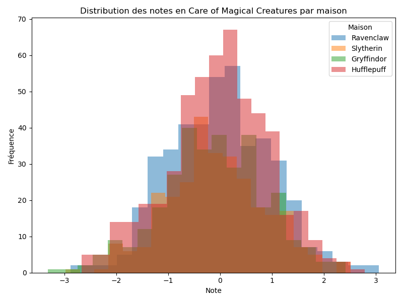

# <span class="h1">DSLR</span>

<div class="badge-section">
<div class="badge-row">
    
    
    
    
    
    
    
</div>
</div>

<p class="intro">
    Deuxième projet de <strong>Machine Learning</strong> : reconstruire le Choixpeau de Poudlard avec une <strong>régression logistique multiclasse</strong> codée de zéro.
</p>

---

## <span class="h2">Présentation</span>

Le Choixpeau magique ne répond plus : il faut le remplacer par un **classifieur** capable de répartir chaque élève dans sa maison. C'est un problème de **classification multiclasse** à quatre classes :

- Gryffondor
- Poufsouffle
- Serdaigle
- Serpentard

Le projet **DSLR** (*Data Science × Logistic Regression*) couvre tout le cycle d'un projet de science des données : **explorer** les données, les **visualiser**, puis **entraîner** un modèle de régression logistique.

```console
dataset_train.csv ──► analyse ──► visualisation ──► standardisation ──► descente de gradient ──► weights.json
dataset_test.csv  ──► sigmoïde ──► argmax ──► houses.csv
```

---

## <span class="h2">Le projet</span>

*Introduction à la classification supervisée.*

**L'objectif** : vivre de bout en bout la chaîne complète du machine learning — de la donnée brute au fichier de prédiction.

!!! warning "La règle du jeu"
    Interdiction d'utiliser une fonction qui fait le travail à notre place :

    - `DataFrame.describe()` de pandas est **explicitement** considéré comme de la triche ;
    - `count`, `mean`, `std`, `min`, `max`, `percentile` doivent être **réécrits à la main** ;
    - la partie obligatoire impose la **descente de gradient** (pas d'optimiseur tout fait).

    Seule l'évaluation finale (le score de précision) s'appuie sur Scikit-Learn.

Le programme se compose de **trois étapes obligatoires** et d'une partie bonus :

1. **`describe.py`** — statistiques descriptives de chaque feature numérique, recalculées maison.
2. **`histogram.py` / `scatter_plot.py` / `pair_plot.py`** — répondre à des questions de visualisation.
3. **`logreg_train.py` → `logreg_predict.py`** — entraîner puis prédire (`houses.csv`).

**En bonus** : une **descente de gradient stochastique (SGD)** et une comparaison du modèle maison avec `sklearn.linear_model.LogisticRegression`.

!!! info "Le seuil du Choixpeau"
    Le sujet fixe la barre : le classifieur n'est comparable au Choixpeau magique qu'à partir de **98 % de précision** sur `dataset_test.csv`.

---

## <span class="h2">Comment ça marche</span>

### 1. Analyser avant de modéliser

`describe.py` calcule pour chaque feature numérique : `count`, `mean`, `std`, `min`, les quartiles (`25 %`, `50 %`, `75 %`) et `max`. La difficulté n'est pas la formule mais **la réécriture** de `mean`, `std` et `percentile` sans pandas.

### 2. Visualiser pour poser les bonnes questions

| Script | Question du sujet |
| ------ | ----------------- |
| `histogram.py` | Quel cours a une répartition **homogène** des notes entre les quatre maisons ? |
| `scatter_plot.py` | Quelles sont les **deux caractéristiques similaires** ? |
| `pair_plot.py` | Quelles caractéristiques choisir pour la **régression logistique** ? |

Le `pair_plot` est l'outil décisif : il montre quelles features **séparent** le mieux les maisons — celles qui deviennent ensuite les entrées du modèle.

### 3. Le classifieur : régression logistique one-vs-all

La régression logistique binaire estime une probabilité via la **sigmoïde** :

```console
σ(z) = 1 / (1 + e^(−z))        avec z = θ₀ + θ₁x₁ + θ₂x₂ + …
```

Pour quatre maisons, on entraîne **un modèle binaire par maison** (*one-vs-all* / *one-vs-rest*) : « Gryffondor contre les autres », « Poufsouffle contre les autres », etc. À la prédiction, on calcule les quatre probabilités et on retient la **plus élevée** (`argmax`).

```python
# Un modèle binaire par maison, sur les mêmes données
theta = gradient_descent(X, y_binary, alpha=0.1, iterations=5000)
```

### 4. Standardiser, puis descendre le gradient

Les notes des cours n'ont pas la même échelle : on **centre et réduit** chaque feature (`(x − moyenne) / écart-type`) avant d'ajouter une colonne de biais. On met ensuite à jour les poids pour minimiser l'erreur :

```console
h        = σ(X · θ)                 # probabilité prédite
gradient = (1/m) · Xᵀ · (h − y)     # direction de la montée
θ       -= α · gradient             # un pas dans le sens opposé
```

!!! tip "Pourquoi standardiser ?"
    Sans centrage-réduction, les features à grande échelle dominent le gradient et la convergence est lente — voire instable. C'est le même réflexe que la normalisation min-max de la **[régression linéaire](linear-regression.md)**.

### 5. Prédire et écrire `houses.csv`

`logreg_predict.py` recharge les poids (`weights.json`), applique la sigmoïde à chaque élève du jeu de test et écrit la maison retenue :

```csv
Index,Hogwarts House
0,Gryffindor
1,Hufflepuff
2,Ravenclaw
3,Hufflepuff
4,Slytherin
```

---

## <span class="h2">Les données & les features</span>

`describe.py` et les visualisations convergent vers un petit sous-ensemble de cours réellement **discriminants** pour la maison :

```python
features = [
    "Herbology",
    "Defense Against the Dark Arts",
    "Astronomy",
    "Charms",
    "Flying",
]   # sélection issues du pair_plot
```

Le `pair_plot` révèle que la **Défense contre les forces du mal**, l'**Astronomie** et les **Sortilèges** séparent nettement les élèves, tandis que d'autres cours sont répartis de façon quasi homogène — l'histogramme de `Care of Magical Creatures` en est l'exemple type :

<figure markdown>
  { loading=lazy .project-architecture width=800 height=600}
  <figcaption>Histogramme du cours « Care of Magical Creatures » : les quatre maisons se recouvrent, cours peu discriminant</figcaption>
</figure>

---

## <span class="h2">Architecture</span>

Le dépôt public est organisé par étape du projet :

```console
DSLR/
├── Bonus/                     # SGD + accuracy_score
│   ├── stochastic_gradient_descent.py
│   ├── logred_predict_bonus.py
│   └── accuracy_score.py
├── Data_Analysis/
│   └── describe.py            # statistiques descriptives maison
├── Data_Utils/                # boîte à outils partagée
│   ├── math.py                # sigmoid, our_mean, our_std, our_percentile
│   ├── logger.py              # logging coloré
│   └── utils.py               # chargement du CSV
├── Data_Visualization/
│   ├── histogram.py           # histogrammes par cours × maison
│   ├── scatter_plot.py        # nuage de points (features similaires)
│   └── pair_plot.py           # sélection des features
├── Logistic_Regression/
│   ├── logreg_train.py        # entraînement (descente de gradient)
│   ├── logreg_predict.py      # prédiction → houses.csv
│   └── houses.csv
├── Scikit_Learn/
│   └── compare_accuracy.py    # modèle maison vs scikit-learn
├── datasets/
│   ├── dataset_train.csv
│   └── dataset_test.csv
├── docs/enonce.md             # sujet du projet
├── requirements.txt
└── README.md
```

---

## <span class="h2">Technologies</span>

<div class="skill-grid">

<div class="skill-card">
    <span class="skill-card-title">Langage</span><br>
    <span class="skill-card-desc"><strong>Python</strong><br><em>scripting, typage des entrées, modules séparés par responsabilité</em></span>
</div>

<div class="skill-card">
    <span class="skill-card-title">Données</span><br>
    <span class="skill-card-desc"><strong>Pandas</strong><br><em>chargement et manipulation des CSV</em><br><strong>NumPy</strong><br><em>algèbre linéaire, produit matriciel, sigmoïde vectorisée</em></span>
</div>

<div class="skill-card">
    <span class="skill-card-title">Visualisation</span><br>
    <span class="skill-card-desc"><strong>Matplotlib</strong><br><em>histogrammes et nuages de points</em><br><strong>Seaborn</strong><br><em>pair plot coloré par maison</em></span>
</div>

<div class="skill-card">
    <span class="skill-card-title">Algorithme</span><br>
    <span class="skill-card-desc"><strong>Régression logistique</strong><br><em>one-vs-all, sigmoïde, descente de gradient</em><br><strong>SGD</strong><br><em>mise à jour exemple par exemple (bonus)</em></span>
</div>

</div>

---

## <span class="h2">Fonctionnalités</span>

| Script | Rôle | Méthode |
| ------ | ---- | ------- |
| `describe.py` | Statistiques descriptives des features numériques | Calculs réécrits à la main |
| `histogram.py` | Distribution des notes par cours et par maison | Matplotlib |
| `scatter_plot.py` | Deux features similaires | Seaborn |
| `pair_plot.py` | Graphique en paires pour choisir les features | Seaborn |
| `logreg_train.py` | Entraîner un modèle binaire par maison, écrire `weights.json` | Descente de gradient |
| `logreg_predict.py` | Prédire la maison de chaque élève → `houses.csv` | Sigmoïde + argmax |
| `stochastic_gradient_descent.py` | Variante SGD de l'optimisation (bonus) | Mise à jour par exemple |
| `compare_accuracy.py` | Comparer modèle maison et Scikit-Learn | `accuracy_score` |

---

## <span class="h2">Problème | Solution</span>

| Problème | Solution |
| ---------- | ---------- |
| Réutiliser `describe()` de pandas est interdit | Réécrire `mean`, `std` et `percentile` dans `Data_Utils/math.py` |
| Un classifieur binaire ne gère pas quatre maisons | Stratégie **one-vs-all** : un modèle binaire par maison |
| La sigmoïde peut déborder (`overflow`) sur de grands `z` | Formules stables et bornage du logarithme (`log(h + 1e-15)`) dans la log-loss |
| Des features aux échelles très différentes ralentissent la convergence | **Standardisation** (centrage-réduction) avant l'entraînement |
| Choisir les bonnes features sans tâtonner | Sélection guidée par le **pair plot** |
| Réutiliser les poids entre entraînement et prédiction | Sérialisation JSON dans **`weights.json`** |
| Mesurer objectivement le résultat | Comparaison avec la référence Scikit-Learn via `accuracy_score` |
| Le sujet exige un score élevé | Jeu de features pertinent + 5 000 itérations à `α = 0,1` |

---

## <span class="h2">Résultats</span>

- **Modèle** : régression logistique one-vs-all, 5 features sélectionnées via le pair plot.
- **Convergence** : descente de gradient, `α = 0,1`, 5 000 itérations.
- **Objectif du sujet** : **98 %** de précision sur `dataset_test.csv`.
- **Bonus** : implémentation de la **descente de gradient stochastique** (shuffle + mises à jour par exemple) et **comparaison chiffrée** avec `LogisticRegression` de Scikit-Learn.
- **Sortie** : `houses.csv` au format exact attendu (`Index,Hogwarts House`).

---

## <span class="h2">Ce que j'ai appris</span>

Passer de la **régression** (prédire une valeur) à la **classification** (prédire une catégorie) tient à un détail : une **sigmoïde** qui transforme un score en probabilité.

Trois réflexes de data scientist, dans l'ordre :

1. **Explorer** les données avant de coder quoi que ce soit.
2. **Visualiser** pour choisir ses features — le pair plot vaut mieux que le tâtonnement.
3. **Standardiser** avant d'optimiser : sans ça, la descente de gradient n'avance pas.

Et la leçon transversale : maintenant que j'ai écrit la sigmoïde, la log-loss et le one-vs-all à la main, `LogisticRegression` de Scikit-Learn n'est plus une boîte noire — c'est une implémentation que je sais lire.

---

<div class="project-card" markdown>

## :material-brain: Tutoriel : la régression logistique de zéro

Tu veux reproduire ce projet pas à pas ?

Le tutoriel couvre l'exploration des données, la visualisation, la sigmoïde, la stratégie one-vs-all, la descente de gradient (et le SGD en bonus), jusqu'à la prédiction de `houses.csv`.

[:octicons-arrow-right-24: Commencer le tutoriel](../ia/dslr.md){ .md-button .md-button--primary }

</div>

---

## <span class="h2">Lien</span>

[:fontawesome-brands-github: Voir le code](https://github.com/Lamizana/DSLR){ .md-button .md-button--primary target="_blank" rel="noopener" }
