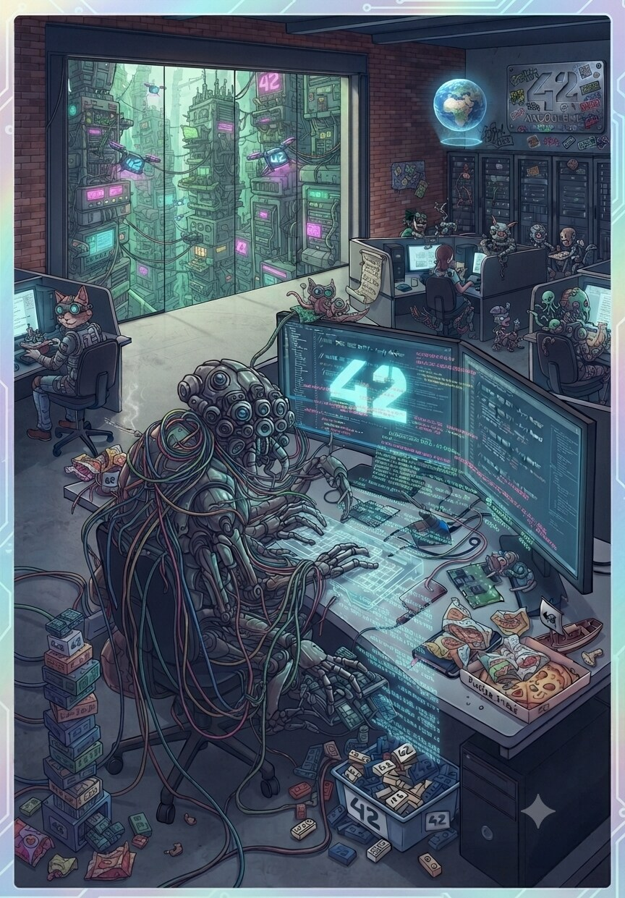

# <span class="h1">TokenizeArt</span>

<div class="badge-section">
<div class="badge-row">
    
    
    
    
    
    
    
</div>
</div>

<p class="intro">
    Création du NFT <strong>Zehd42 (Z42)</strong> sur la BNB Smart Chain Testnet : mon premier <strong>jeton non fongible</strong>.
</p>

---

## <span class="h2">Présentation</span>

Un **NFT** `Zehd42 (Z42)` conforme à la norme **BEP-721 / ERC-721**, déployé sur la **BNB Smart Chain Testnet** : un jeton unique portant le chiffre **42**, avec son image et ses métadonnées hébergées sur **IPFS** et un mint réservé au propriétaire.

<figure markdown>
  { loading=lazy .project-architecture width=864 height=1241}
  <figcaption>L'œuvre : Zehd42 (Z42), le NFT unique portant le 42</figcaption>
</figure>

---

## <span class="h2">Contexte</span>

*Projet solo réalisé dans le cadre du partenariat **42 × BNB Chain**.*

**L'objectif** : comprendre concrètement le cycle de vie d'un **jeton non fongible** en créant, minant et vérifiant un NFT réel sur un réseau de test, sans jamais engager d'argent réel.

C'est le second volet de mon parcours blockchain après [Tokenizer](tokenizer.md) : là où un token BEP-20 est **fongible** (un G42 en vaut un autre), un NFT est **unique** - et cette unicité change tout : identifiant propre, métadonnées externalisées, notion de propriété.

---

## <span class="h2">Mon rôle</span>

Projet **100 % solo**, mené de bout en bout :

- Conception de l'**œuvre** contenant le chiffre 42 (exigence du sujet)
- Rédaction du **smart contract** `zehd42.sol` en Solidity, hérité d'OpenZeppelin
- **Publication de l'image et des métadonnées** sur IPFS via Pinata (deux CID distincts)
- **Déploiement** sur la BSC Testnet via Remix + MetaMask
- **Minage** du tokenId `1` et vérification de la propriété sur la chaîne
- **Vérification** du code source sur BscScan
- Rédaction de la **documentation** (livre blanc, tutoriel pas à pas, guides IPFS & Pinata)

---

## <span class="h2">Architecture</span>

Un **contrat unique** `Zehd42` qui **hérite** de `ERC721URIStorage` et d'`Ownable` (OpenZeppelin v5.1.0). L'héritage fournit les fonctions natives de la norme : `ownerOf`, `balanceOf`, `transferFrom`, `safeTransferFrom`, `approve`…

Le contrat ajoute sa **logique métier** : un compteur d'identifiants (`_tokenIds`), un `mintNFT` réservé au propriétaire, et un `setBaseURI` pour faire évoluer l'emplacement des métadonnées sans redéployer.

```
Zehd42 is ERC721URIStorage, Ownable (OpenZeppelin v5.1.0)
├── from ERC721  : ownerOf, balanceOf, transferFrom, safeTransferFrom, approve…
├── from Ownable : onlyOwner, transferOwnership
├── _tokenIds    : compteur privé d'identifiants (le premier vaut 1)
├── mintNFT()    : crée le NFT réservé au propriétaire, associe les métadonnées IPFS
└── setBaseURI() : change l'URI des prochains mints (jetons déjà minés inchangés)
```

Les données sont réparties sur **deux étages** : la **blockchain** porte le contrat, la propriété et le `tokenId` ; **IPFS** porte l'image et le JSON de métadonnées, référencés par `tokenURI`.

!!! note "Pourquoi stocker l'image hors chaîne ?"
    Écrire une image dans la blockchain coûterait des sommes considérables. Le contrat ne stocke donc que l'**empreinte** du fichier : c'est le rôle du CID IPFS. Voir [IPFS & Pinata](../web/web3/ipfs.md).

---

## <span class="h2">Technologies</span>

<div class="skill-grid">

<div class="skill-card">
    <span class="skill-card-title">Langage</span><br>
    <span class="skill-card-desc"><strong>Solidity ^0.8.20</strong><br><em>Typé et compilé pour l'EVM</em></span>
</div>

<div class="skill-card">
    <span class="skill-card-title">Bibliothèque</span><br>
    <span class="skill-card-desc"><strong>OpenZeppelin v5.1.0</strong><br><em>ERC721URIStorage + Ownable, la référence ERC-721</em></span>
</div>

<div class="skill-card">
    <span class="skill-card-title">Stockage distribué</span><br>
    <span class="skill-card-desc"><strong>IPFS</strong><br><em>image et métadonnées adressées par contenu (CID)</em><br><strong>Pinata</strong><br><em>service d'épinglage</em></span>
</div>

<div class="skill-card">
    <span class="skill-card-title">Supports</span><br>
    <span class="skill-card-desc"><strong>Remix IDE</strong><br><em>écriture, compilation et déploiement</em><br><strong>MetaMask</strong><br><em>portefeuille connecté (Injected Provider)</em><br><strong>BscScan Testnet</strong><br><em>explorateur et vérification du contrat</em></span>
</div>

<div class="skill-card">
    <span class="skill-card-title">Réseau</span><br>
    <span class="skill-card-desc"><strong>BNB Smart Chain Testnet</strong><br><em>blockchain EVM, Chain ID 97</em></span>
</div>

</div>

---

## <span class="h2">Fonctionnalités</span>

| Fonction | Rôle | Accès |
| -------- | ---- | ----- |
| `mintNFT(recipient)` | Créer un NFT unique et lui associer les métadonnées | Propriétaire |
| `ownerOf(tokenId)` | Connaître le propriétaire d'un NFT | Lecture |
| `balanceOf(owner)` | Nombre de NFT détenus par une adresse | Lecture |
| `tokenURI(tokenId)` | URL des métadonnées IPFS associées | Lecture |
| `baseURI()` | URI de base utilisée pour les prochains mints | Lecture |
| `transferFrom(from, to, tokenId)` | Transférer un NFT | Propriétaire ou approuvé |
| `safeTransferFrom(...)` | Transfert sûr vers un contrat | Propriétaire ou approuvé |
| `approve` / `setApprovalForAll` | Autoriser un tiers à transférer | Propriétaire |
| `setBaseURI(newURI)` | Changer l'URI des prochains mints | Propriétaire |

---

## <span class="h2">Problème | Solution</span>

| Problème | Solution |
| -------- | -------- |
| Un NFT doit être **unique**, contrairement à un token fongible | Norme BEP-721 : à chaque mint, un `tokenId` incrémenté par le compteur `_tokenIds` |
| Stocker l'œuvre sur la blockchain serait hors de prix | Image et métadonnées publiées sur **IPFS** ; seul le CID est référencé par le contrat |
| Un lien vers un serveur central peut mourir | Épinglage IPFS via **Pinata** : le CID reste résolvable, sans point de défaillance unique |
| Les wallets affichent une case vide au lieu de l'image | `tokenURI` pointe vers le **JSON de métadonnées**, dont le champ `image` utilise une **URL HTTPS de passerelle** (et non `ipfs://`) |
| Un caractère parasite peut casser l'affichage | Champs d'URL vérifiés caractère par caractère (bug rencontré et corrigé en cours de projet) |
| N'importe qui ne doit pas pouvoir créer un NFT | `mintNFT` protégé par `onlyOwner` ; l'appel par un tiers échoue en `revert` |
| Faire évoluer les métadonnées sans redéployer | `setBaseURI(...)`, réservé au propriétaire, n'affecte que les mints suivants |
| Éviter les transferts perdus vers un contrat | `_safeMint` / `safeTransferFrom`, qui vérifient que le destinataire accepte le NFT |
| Déployer sans argent réel | Testnet BSC + faucet tBNB gratuit - zéro argent réel engagé |

---

## <span class="h2">Résultats</span>

- Smart contract `0x3fcCab7bb70aa5BCA5706B83e6Fcf08F80526ce9` déployé sur la **BSC Testnet** ([transaction de déploiement](https://testnet.bscscan.com/tx/0x717d3eaf6b7001b2dee9e4cc29d15b94fb7023ce89e42379c3c475ddb5663232){ target="_blank" rel="noopener" })
- Contrat **vérifié sur BscScan** : code source public, transactions traçables
- NFT **`Zehd42 (Z42)`**, jeton unique conforme à la norme **BEP-721**
- **tokenId `1`** miné vers `0x69eF124b2033A69C6061cf88FfFBAE913E169fB2`, propriété vérifiée par `ownerOf(1)`
- `tokenURI(1)` renvoie les métadonnées **IPFS** (CID JSON : `bafkrei…numeb4pe`)
- **Deux fichiers épinglés** sur IPFS via Pinata : l'image (`bafybei…44eejcu`) et son JSON de métadonnées
- Code source, livre blanc et tutoriel documentés dans le dépôt

!!! tip "Explorer le résultat"
    **NFT miné** : [voir le tokenId 1 sur BscScan](https://testnet.bscscan.com/token/0x3fcCab7bb70aa5BCA5706B83e6Fcf08F80526ce9?a=1){ target="_blank" rel="noopener" }

---

## <span class="h2">Ce que j'ai appris</span>

La différence entre un token **fongible** et un NFT n'est pas cosmétique : un NFT vit sur **deux étages**, et c'est cette séparation qui le fait tenir. Le contrat garantit l'unicité et la propriété ; **IPFS** garantit la pérennité de l'œuvre. Déployer le contrat ne suffit donc pas - il faut aussi **publier et épingler** les fichiers, et vérifier que le lien entre les deux est correct.

Le lien est justement le point le plus fragile : une URL avec un espace en trop, un `tokenURI` qui pointe vers l'image plutôt que vers le JSON, et le wallet affiche une **case vide** alors que tout est « déployé ». Raisonner sur les **données avant la mise en ligne**, et non après, reste la compétence centrale du développement blockchain.

Enfin, la **vérification du code sur BscScan** change la nature du livrable : elle transforme un contrat opaque en document public lisible et auditable par n'importe qui.

---

<div class="project-card" markdown>

## :material-robot-love: Tutoriel : Créer votre NFT BEP-721

Tu veux reproduire ce projet ? Consulte ce tutoriel qui couvre l'intégralité du processus, de l'installation de MetaMask à la vérification sur BscScan, avec la publication des métadonnées sur IPFS.

[:octicons-arrow-right-24: Commencer le tutoriel](../web/web3/tokenizeart.md){ .md-button .md-button--primary }

</div>

---

## <span class="h2">Lien</span>

[:fontawesome-brands-github: Voir le code](https://github.com/Lamizana/TokenizeArt){ .md-button .md-button--primary target="_blank" rel="noopener" }
[:octicons-verified-24: Contrat sur BscScan](https://testnet.bscscan.com/address/0x3fcCab7bb70aa5BCA5706B83e6Fcf08F80526ce9){ .md-button target="_blank" rel="noopener" }
[:simple-ipfs: Métadonnées sur IPFS](https://gateway.pinata.cloud/ipfs/bafkreibd2pph7dcwz7ewgtr73x3iwxmibux4bsb5ebqtg242n2numeb4pe){ .md-button target="_blank" rel="noopener" }
